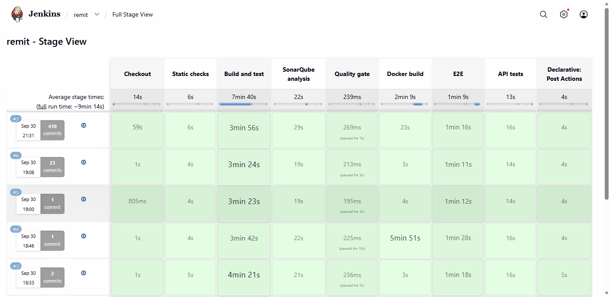
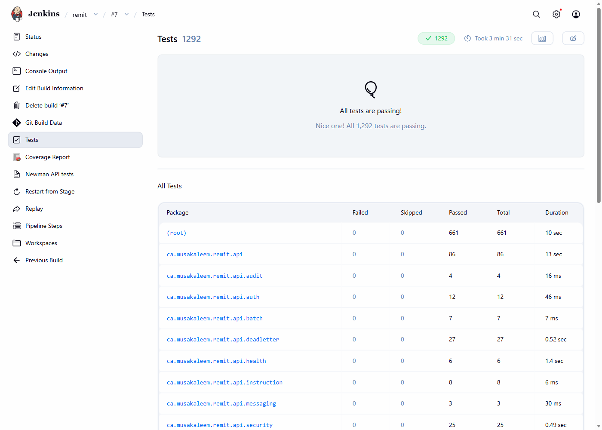
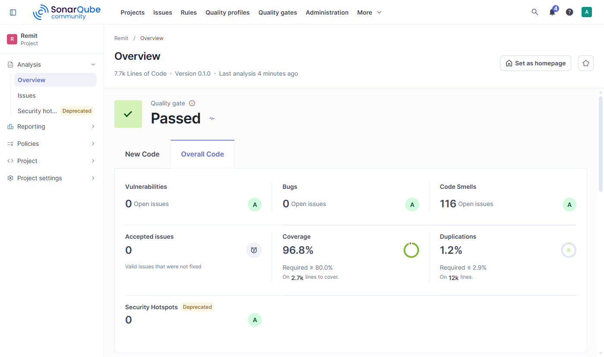
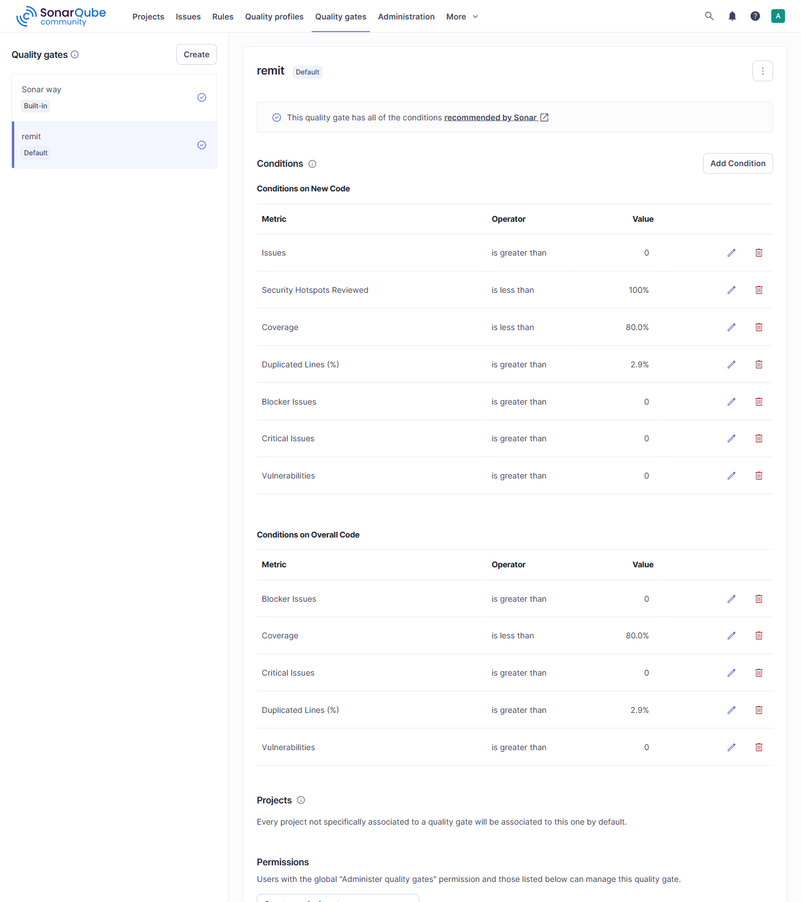

# Remit

[](https://github.com/Musa-Kal/remit/actions/workflows/ci.yml)

Remit is a payment file gateway. Clients drop CSV payment batch files on an SFTP server; `intake-service` picks them up, validates every payment instruction with Spring Batch, and publishes valid instructions to Kafka. `routing-service` consumes those instructions idempotently and routes each one to a payment channel (EFT, WIRE, INTERAC), dead-lettering failures after retries. `api-service` gives operators a JWT-secured REST API to monitor batches, inspect rejected rows, and replay dead-lettered messages, and it writes every state change to an append-only audit trail in MongoDB. No real money moves and no real bank is involved: channel limits and rules are illustrative.

## Architecture

```
            +-----------+       SFTP poll        +-------------------+
 client --> | SFTP      | <--------------------- |  intake-service   |
 drops CSV  | /inbound  |  download, move file   |  (Spring Batch)   |
            +-----------+                        +---------+---------+
                                                           |
                       payments.instructions  (valid)      |   payments.rejected (invalid rows)
                       payments.batch-events                v
                                                  +-------------------+
                                                  |      Kafka        |
                                                  +----+---------+----+
                                                       |         ^
                         consume instructions          |         | routed + status events
                                                       v         |
                                                  +-------------------+      +---------+
                                                  |  routing-service  | ---> | MySQL   |
                                                  |  (idempotent)     |      | routing |
                                                  +---------+---------+      +---------+
                                                            | failures after retries
                                                            v
                                                  payments.instructions.DLT
                                                            |
                                                            v
 operator --JWT--> +-------------------+  consumes batch/status/rejected/DLT events
                   |    api-service    | ---> MySQL (api read model)
                   | (Spring Web/Sec)  | ---> MongoDB (audit_events, append-only)
                   +-------------------+  replay: republish DLT payload to payments.instructions
```

Each service owns its own MySQL schema (`remit_intake`, `remit_routing`, `remit_api`) and never reads another service's data; everything crosses service boundaries as a Kafka event. See [ADR 0001](docs/decisions/0001-service-boundaries.md).

## Stack

| Technology | Version | Where it is used |
|---|---|---|
| Java | 17 (Temurin) | All modules, compiled with `--release 17`; `eclipse-temurin:17-jre` runtime images |
| Spring Boot | 3.5.16 | The three services; Maven multi-module build with the Boot parent |
| Spring Web | Boot 3.5 | api-service REST controllers (`BatchController`, `InstructionController`, `DeadLetterController`, ...), RFC 7807 errors, springdoc Swagger UI |
| Spring Security | 6 (Boot 3.5) | api-service: stateless filter chain (`SecurityConfig`), JWT bearer filter (`JwtAuthenticationFilter`, jjwt 0.12), `@PreAuthorize` roles OPERATOR and ADMIN, BCrypt users |
| Spring Batch | 5.2 | intake-service job `ingestPaymentFileJob`: validation tasklet, chunk step with skip policy and skip listener, finalize tasklet, restartable from the last chunk |
| Spring Data JPA / Hibernate | Boot 3.5 | Entities and repositories in all three services (`FileRegistryEntry`, `ProcessedInstruction` with `@Version`, the api read model); `ddl-auto=validate` |
| MySQL | 8.4 | One schema per service: `remit_intake`, `remit_routing`, `remit_api`, migrated by Flyway |
| Apache Kafka | 3.9 (KRaft) | Eight `payments.*` topics; Spring Kafka producers (`acks=all`, idempotence) and consumers (manual ack, `ErrorHandlingDeserializer`, `DefaultErrorHandler` with a dead-letter topic) |
| MongoDB | 7.0 | api-service audit trail `remit_audit.audit_events`, insert-only (`MongoAuditEventStore`) |
| SFTP | atmoz/sftp, Spring Integration SFTP | Client drop zone (`/inbound`, `/processing`, `/processed`, `/error`), polled by intake-service through `SftpFileGateway` |
| Docker | Compose v2 | Two-stage `Dockerfile` per service; `docker-compose.yml` runs the infrastructure and the services |
| Kubernetes | kustomize, kind | `k8s/base` and `k8s/overlays/local`, verified on kind ([Kubernetes](#kubernetes-local)) |
| Bash | Git Bash works on Windows | `scripts/`: build, deploy, restart, seed, logs, smoke and performance tests, cluster lifecycle; shellcheck-clean |
| Jenkins | LTS, JDK 17 | Primary pipeline (`Jenkinsfile`, `ci/`): static checks, tests, SonarQube, images, E2E, Newman |
| JUnit 5, Mockito, AssertJ, Testcontainers | Boot 3.5 BOM, Testcontainers 1.21 | 631 unit and integration tests against real MySQL, Kafka, MongoDB and SFTP containers ([Testing](#testing)) |
| Postman / Newman | Collection v2.1 | `postman/remit.postman_collection.json`, run by `scripts/newman.sh` and Jenkins ([API tests](#api-tests-postmannewman)) |
| SonarQube | Community Build | Quality gate `remit` in the Jenkins pipeline ([CI](#ci)) |
| Code quality | Spotless 3.10 (google-java-format 1.28), JaCoCo 0.8.15 | Format check and an 80% line coverage gate per module in `./mvnw verify`; OWASP Dependency-Check as an optional report (`-Powasp`) |

## Repository layout

| Path | Contents |
|---|---|
| `remit-common/` | Shared event records, enums, topic names, masking utilities |
| `intake-service/` | SFTP polling and the Spring Batch ingestion job |
| `routing-service/` | Idempotent Kafka consumer, channel routing, retries and the dead-letter topic |
| `api-service/` | Operator REST API, security, read model, audit writer |
| `docker/` | Init scripts for MySQL, MongoDB and Kafka topics used by compose |
| `docker-compose.yml` | Local stack: infrastructure and the three services |
| `k8s/` | Kustomize base for the three services, the local overlay with MySQL, MongoDB, Kafka and SFTP, and the kind cluster config ([Kubernetes](#kubernetes-local)) |
| `*/Dockerfile` | Multi-stage image build of each service |
| `samples/` | The five sample batch files (see [Intake](#intake-service)) |
| `scripts/` | Bash ops scripts: build, deploy (compose or kind), restart, seed SFTP, logs, smoke and performance tests, local cluster lifecycle |
| `postman/` | Postman collection and environments for the operator API ([API tests](#api-tests-postmannewman)) |
| `Jenkinsfile` | Declarative CI pipeline ([CI](#ci)) |
| `ci/` | Local Jenkins, Docker-in-Docker and SonarQube stack with its setup script ([ci/README.md](ci/README.md)) |
| `.github/workflows/ci.yml` | GitHub Actions mirror of the static checks and the build |
| `docs/api.md` | Operator API reference: endpoints, auth flow, examples, error format |
| `docs/openapi.json` | OpenAPI document exported by the build |
| `docs/runbook.md` | Operational procedures (restart a service in compose or Kubernetes, restart a failed batch job, inspect and replay the DLT, rotate the JWT secret and the Kubernetes secrets) |
| `docs/e2e-expectations.md` | Expected outcome of every sample file |
| `docs/decisions/` | Architecture decision records |

## Build

Requires JDK 17. The Maven wrapper downloads Maven 3.9.9 on first use.

```bash
./mvnw -B verify          # compile, unit + integration tests, Spotless check, JaCoCo gate
./mvnw -B spotless:apply  # reformat Java sources with google-java-format
./mvnw -B -Powasp verify  # optional OWASP dependency report (target/dependency-check-report.html)
./mvnw -B sonar:sonar     # SonarQube analysis after verify (-Dsonar.host.url=... -Dsonar.token=...; CI: ci/README.md)
```

The JaCoCo check fails any module whose line coverage drops below 80%.

## Quick start

Prerequisites: Docker with Compose v2, Bash (Git Bash works on Windows), `curl` and `jq`. JDK 17 is only needed to build and test outside Docker; the images compile the code themselves.

```bash
git clone https://github.com/Musa-Kal/remit.git && cd remit
cp .env.example .env              # then replace every change-me value (openssl rand -base64 48 for the JWT secret)
scripts/deploy.sh compose         # builds missing images, starts everything, waits until all services are healthy
scripts/smoke-test.sh --keep      # uploads the five samples, asserts every outcome through the API, leaves the stack up
```

To drop the samples without the checks, run `scripts/seed-sftp.sh` instead of the smoke test. Use one or the other on a fresh stack: the samples are accepted only once (duplicate file detection), so `smoke-test.sh` refuses a stack that already holds batches unless it is given `--reset`, which starts from empty volumes. Without `--keep` it removes the stack when it is done.

Then:

- Swagger UI: <http://localhost:8080/swagger-ui.html> (log in with `POST /api/v1/auth/login` as `operator` or `admin` and the passwords from `.env`, then use **Authorize** with the token)
- Kafka UI: `docker compose --profile tools up -d kafka-ui`, then <http://localhost:8090> (the local Jenkins of [CI](#ci) uses 8090 too; set `KAFKA_UI_PORT` in `.env` when both run)
- Logs: `scripts/logs.sh intake-service` (JSON, pretty-printed with jq)
- Stop: `docker compose down` (keeps data) or `docker compose down -v` (deletes all volumes)

With image layers already built, `docker compose down -v` followed by `docker compose up -d --build` reached all-healthy in 52 s (Windows 11, Docker Desktop, 20 CPUs; the builds were cache hits). The first build of the three images downloads the Maven dependencies and takes about 2 minutes per image.

### Services and ports

| Service | Host address | What it provides |
|---|---|---|
| `api-service` | `localhost:8080` | Operator REST API, Swagger UI, actuator health |
| `intake-service` | `localhost:8081` | Actuator health and `/actuator/ingestjobs` (job executions and restarts, see the runbook) |
| `routing-service` | `localhost:8082` | Actuator health |
| `mysql` (8.4) | `localhost:3307` | Schemas `remit_intake`, `remit_routing`, `remit_api`; users of the same names, each granted only on its own schema |
| `mongo` (7.0) | `localhost:27018` | Database `remit_audit` with collection `audit_events` and its indexes; the app user can insert and read but not update or delete |
| `kafka` (3.9, KRaft) | `localhost:29092` (host), `kafka:9092` (compose network) | Single broker, topic auto-creation disabled |
| `kafka-init` | none | Creates the eight `payments.*` topics with 3 partitions, then exits 0 |
| `sftp` (atmoz/sftp) | `localhost:2222` | User `REMIT_SFTP_USER` with `inbound`, `processing`, `processed`, `error` |
| `kafka-ui` (tools profile) | `localhost:8090` | Browse topics and messages |

Notes:

- The three services run the `docker` profile and wait for healthy MySQL, MongoDB and SFTP and for `kafka-init` to finish. They get only the variables they need from `.env`; the `REMIT_*_HOST` values in `.env` are for services run outside compose.
- Compose pins the business date to 2026-10-15 (`REMIT_CLOCK_FIXED_DATE`, [ADR 0005](docs/decisions/0005-demo-clock.md)) so the committed samples always validate, polls SFTP every 10 s (`REMIT_SFTP_POLL_INTERVAL`), and turns on the `FORCE_FAIL` chaos hook.
- MySQL runs with `innodb_flush_log_at_trx_commit=2` and `sync_binlog=0`: a crash can lose the last second of commits, a fair trade for a local stack where per-commit fsyncs made routing about four times slower (see [Measured performance](#measured-performance) and [ADR 0011](docs/decisions/0011-local-stack-settings.md)).
- MySQL and MongoDB publish on 3307 and 27018 so they do not clash with native installs; change `REMIT_MYSQL_PORT` / `REMIT_MONGO_PORT` in `.env` if needed.
- The init scripts in `docker/` run only when a data volume is empty. After changing a password in `.env`, recreate with `docker compose down -v`.
- The SFTP host key is regenerated whenever the container is recreated, so local clients should not pin it.
- To run a service from an IDE or with `java -jar` (the "Run it locally" sections below), stop its container first, for example `docker compose stop api-service`; otherwise both hold the same port and share the Kafka consumer group.

### Container images

Each service has a two-stage `Dockerfile` built from the repository root (it needs the parent pom and `remit-common`):

1. `maven:3-eclipse-temurin-17` copies the poms first and resolves dependencies in their own layer, so a code change does not download anything again, then packages the service with `-DskipTests` (tests run in `./mvnw verify` and CI, not in the image build).
2. `eclipse-temurin:17-jre` receives the Spring Boot layers (`java -Djarmode=tools -jar app.jar extract --layers`, the Boot 3.3+ successor of `layertools`) as four `COPY` layers: dependencies, loader, snapshot dependencies, application. It runs as uid 10001 with `-XX:MaxRAMPercentage=75`, and `HEALTHCHECK` curls `/actuator/health`. Extra JVM flags go in `JAVA_TOOL_OPTIONS`.

Images are named `remit/<service>:<tag>`; compose uses `REMIT_IMAGE_TAG` (default `latest`) and `scripts/build.sh` tags both the git short SHA and `latest`.

### Scripts

All scripts take `-h` for help, use `set -euo pipefail`, read `.env`, and pass `shellcheck scripts/*.sh` with zero warnings. The Kubernetes ones use the kubectl context `kind-remit` unless `REMIT_KUBE_CONTEXT` names another (empty: the current context).

| Script | What it does |
|---|---|
| `scripts/build.sh [--skip-tests]` | `./mvnw -B verify`, then builds the three images tagged with the git short SHA and `latest` |
| `scripts/deploy.sh compose\|k8s` | `compose`: `docker compose up -d` (`--build` to rebuild) and waits up to 180 s for every service to be healthy, printing each status. `k8s`: runs `scripts/k8s-up.sh` (`--build` passed on) |
| `scripts/restart.sh <service> [compose\|k8s]` | Restarts one service and waits until it is healthy again (`kubectl rollout restart` and `rollout status` for k8s) |
| `scripts/seed-sftp.sh [file...]` | Uploads files (default: `samples/*.csv`) to `/inbound`. Default transport streams them into the compose `sftp` container (needs only the docker CLI); `--via kubectl` does the same into the kind cluster's sftp pod; `--via sftp` uses `sftp` and `sshpass` like a real client |
| `scripts/logs.sh <service> [compose\|k8s]` | Follows a service's JSON logs, pretty-printed with jq (`-c` compact, `--no-follow`, `-n LINES`); `k8s` follows every pod of the deployment |
| `scripts/gen-batch.sh <clientId> <rows>` | Generates a valid batch file; `-r FORCE_FAIL` makes every row fail in routing |
| `scripts/smoke-test.sh [--target compose\|k8s]` | End-to-end test of the samples and a dead-letter replay ([Sample walkthrough](#sample-walkthrough)); `--target k8s` runs it against the kind deployment |
| `scripts/newman.sh [-e local|docker] [--base-url URL]` | Runs the Postman collection with Newman (cli, JUnit and HTML reports in `newman/`) ([API tests](#api-tests-postmannewman)) |
| `scripts/perf-test.sh` | NFR-05 measurement with a 10,000-row file ([Measured performance](#measured-performance)) |
| `scripts/k8s-up.sh [--build]` | Creates the kind cluster `remit` if needed, loads the images, creates the Secret, applies the local overlay and waits for every rollout ([Kubernetes](#kubernetes-local)) |
| `scripts/k8s-down.sh [--keep-cluster]` | Deletes the kind cluster, or with `--keep-cluster` only the `remit` namespace and its volumes |
| `scripts/k8s-secrets.sh [--restart]` | Creates or updates the `remit-secrets` Secret from `.env` without printing a value; `--restart` rolls the services so they read it |
| `scripts/lib.sh` | Helpers sourced by the other scripts (`.env` loading, logging, compose and kubectl wrappers, health waits) |

Every file lands in `/inbound` under a hidden `.part` name and is renamed once complete, so the poller never reads a partial upload.

## Kubernetes (local)

`k8s/` holds kustomize manifests, verified on a local [kind](https://kind.sigs.k8s.io/) cluster:

- `k8s/base`: namespace `remit`, a Deployment and ClusterIP Service per service (routing-service with 2 replicas and a PodDisruptionBudget), the shared ConfigMap `remit-config` (`SPRING_PROFILES_ACTIVE=k8s`), CPU and memory requests and limits (250m/512Mi to 1 CPU/1Gi), startup, liveness (`/actuator/health/liveness`) and readiness (`/actuator/health/readiness`) probes, and a restricted security context: uid 10001, non-root, read-only root file system with `emptyDir` volumes for `/tmp` and intake's `/staging`, no privilege escalation, all capabilities dropped, `RuntimeDefault` seccomp. Each service reads only the keys of the Secret `remit-secrets` it needs; `k8s/base/secret.example.yaml` documents the keys with placeholders, and `scripts/k8s-secrets.sh` creates the real Secret from `.env`.
- `k8s/overlays/local`: the base plus `infra/` (MySQL 8.4, MongoDB 7 and a single-node KRaft Kafka 3.9 as one-replica StatefulSets, SFTP as a Deployment, small volumes from kind's default StorageClass, a `kafka-init` Job for the topics; no operators). The init scripts are the ones compose uses (`docker/`), turned into ConfigMaps, so the overlay is rendered with `kubectl kustomize --load-restrictor LoadRestrictionsNone k8s/overlays/local` (a plain `kubectl apply -k` refuses files outside the overlay). The overlay also sets the compose demo values: SFTP poll every 10 s, business date 2026-10-15, chaos hook on, seeded operator and admin users.
- `k8s/kind-config.yaml`: one node, node port 30080 published on `127.0.0.1:8080`.

**Exposure:** api-service is a `NodePort` Service (30080) in the local overlay, and the kind config maps that port to `localhost:8080`, so the API, Swagger UI, the smoke test and Newman use the same URL as compose. The alternative, for a cluster without the port mapping, is `kubectl -n remit port-forward svc/api-service 8080:8080`. [ADR 0013](docs/decisions/0013-kubernetes-local-overlay.md) explains these choices.

Prerequisites: Docker, [kind](https://kind.sigs.k8s.io/docs/user/quick-start/#installation), kubectl, Bash, `curl`, `jq`, and a filled `.env`. Port 8080 must be free: stop the compose stack first (`docker compose down`).

```bash
scripts/k8s-up.sh                        # or: scripts/deploy.sh k8s
kubectl -n remit get pods                # all Running, kafka-init Completed
scripts/smoke-test.sh --target k8s       # 70 checks against http://localhost:8080
scripts/restart.sh routing-service k8s   # rollout restart and wait
scripts/logs.sh api-service k8s          # JSON logs of every api-service pod
scripts/k8s-down.sh                      # delete the cluster (--keep-cluster: only the namespace)
```

`k8s-up.sh` is safe to rerun. It creates the cluster if it is missing, builds the images if they do not exist (`--build` forces a rebuild with `scripts/build.sh --skip-tests`), loads them into the node with `kind load docker-image` (skipped when the node already has that image ID; a service whose image changed is restarted), applies the namespace, the Secret and the overlay, then waits for MySQL, MongoDB, Kafka, SFTP, the `kafka-init` Job and the three deployments, and prints the pods. The services start in order without crash loops: each waits in an init container until its dependencies accept connections.

`smoke-test.sh --target k8s` never deploys or tears down: it uses the running cluster, uploads the samples with `kubectl exec` into the sftp pod (`seed-sftp.sh --via kubectl`) and checks the SFTP directories the same way. The samples are accepted once per database, so reset the data between runs with `scripts/k8s-down.sh --keep-cluster && scripts/k8s-up.sh` (about 1.5 minutes, the images stay loaded). `scripts/newman.sh` runs the Postman collection against the cluster unchanged. Pods read `remit-config` and `remit-secrets` at startup only; after changing either, restart the services (`scripts/k8s-secrets.sh --restart`, see the [runbook](docs/runbook.md#rotate-secrets-in-kubernetes)).

Verified on 2026-09-30 with kind v0.33.0, kubectl client v1.34.1 (kustomize v5.7.1), node image `kindest/node:v1.37.0` (pinned by digest in `k8s/kind-config.yaml`), Docker Desktop 29.5.2 on Windows 11 (WSL 2, 11.7 GiB for the Docker VM, 20 CPUs), Git Bash:

| Step (from no cluster, node image already pulled) | Time |
|---|---|
| `kind create cluster` | 49 s |
| `kind load docker-image` of the three images (about 600 MB each) | 43 s (12 to 15 s each) |
| Infrastructure ready and topics created (the node pulls mysql, mongo, kafka and sftp) | 76 s |
| Services ready | 35 s |
| **`scripts/k8s-up.sh` total** | **210 s** |
| `scripts/smoke-test.sh --target k8s` | 53 s, 70 of 70 checks passed (samples settled 8 s after the upload) |
| `scripts/restart.sh routing-service k8s` | 52 s |
| `scripts/k8s-down.sh` | 7 s |

The very first run also downloaded the node image (cluster creation 73 s, total 293 s). A rerun against a running cluster takes about 35 s. kubectl 1.34 warns that it is more than one minor version from the 1.37 server; every command above worked, and a kubectl of 1.36 or newer avoids the warning. Newman against the cluster: 98 requests, 687 assertions, 0 failures.

## Sample walkthrough

After `scripts/deploy.sh compose` and `scripts/seed-sftp.sh`, intake-service picks the five files up on its next poll (within 10 s) in file name order, and the API has settled a few seconds later. `scripts/smoke-test.sh` checks all of the following automatically (70 checks); to look yourself:

```bash
set -a; . ./.env; set +a
TOKEN=$(curl -s -X POST localhost:8080/api/v1/auth/login -H 'Content-Type: application/json' \
  -d "{\"username\":\"operator\",\"password\":\"$REMIT_OPERATOR_PASSWORD\"}" | jq -r .accessToken)
curl -s localhost:8080/api/v1/stats/summary -H "Authorization: Bearer $TOKEN" | jq
curl -s "localhost:8080/api/v1/batches?clientId=ACME01" -H "Authorization: Bearer $TOKEN" | jq '.content[] | {fileName, status, totalRows, acceptedRows, rejectedRows, failureReason}'
```

| File | What it exercises | What the API shows |
|---|---|---|
| `PAY_ACME01_20261015093000.csv` | The happy path: 10 valid rows over EFT, WIRE and INTERAC | Batch `COMPLETED`, 10/10 accepted, 10 instructions `ROUTED`; the file moves to `/processed` |
| `PAY_ACME01_20261015100000.csv` | Row-level validation: 20 rows, one invalid account, amount, currency, value date and INTERAC limit; one row repeats `ACME-0003` from the first file | Batch `COMPLETED_WITH_ERRORS`, 15 accepted, 5 rejected; `/batches/{id}/rejections` lists lines 4, 7, 10, 14, 17 with their reason codes and masked accounts; 14 instructions `ROUTED`, because routing-service recognises `ACME-0003` as a duplicate (`duplicateDeliveries: 1`, and its history on `/instructions/{key}` ends with `DUPLICATE`, detail `already ROUTED`) |
| `PAY_ACME01_20261015110000.csv` | Duplicate file: byte-identical to the first file | Batch `FAILED` with `failureReason: DUPLICATE_FILE` and no rows; the file moves to `/error` next to a `.error.txt` note |
| `PAY_BETA02_20261015120000.csv` | File-level validation: the trailer's control total is 100.00 too high | Batch `FAILED` with `failureReason: CONTROL_TOTAL_MISMATCH`, 4 rows read, none published; `/error` |
| `PAY_BETA02_20261015130000.csv` | Review path and client-scoped keys: two WIREs of 1,000,000.00 or more; reuses the reference `ACME-0001`, which is a new instruction for another client | Batch `COMPLETED`, 4 `ROUTED` and 2 `REQUIRES_REVIEW` |

Totals (`GET /api/v1/stats/summary`): batches 2 `COMPLETED`, 1 `COMPLETED_WITH_ERRORS`, 2 `FAILED`; instructions 28 `ROUTED`, 2 `REQUIRES_REVIEW`; `rejectedRows` 5; `duplicateDeliveries` 1; no dead letters. Every batch event, rejection and status change is also in the audit trail (`GET /api/v1/audit-events`, admin). The full table, including the Kafka side, is [docs/e2e-expectations.md](docs/e2e-expectations.md).

To see a dead letter and a replay, drop a file whose remittance info trips the chaos hook:

```bash
scripts/seed-sftp.sh "$(REMIT_CLOCK_FIXED_DATE=2026-10-15 scripts/gen-batch.sh -o /tmp -r FORCE_FAIL CHAOS01 1)"
curl -s "localhost:8080/api/v1/dead-letters?status=PENDING" -H "Authorization: Bearer $TOKEN" | jq '.content[] | {id, status, replayCount}'
```

After three attempts (about 3 s) the instruction is `DEAD_LETTERED` and a `PENDING` dead letter appears. A replay by `admin` (`POST /api/v1/dead-letters/{id}/replay`) answers 202, a second one while it is pending 409; the replay fails again because the hook is still on, the dead letter returns to `PENDING` with `replayCount` 1, and after the third replay it is `EXHAUSTED`. See [Replay a DLT message](docs/runbook.md#replay-a-dlt-message).

## API summary

api-service serves the operator API under `/api/v1` on port 8080. Swagger UI is at <http://localhost:8080/swagger-ui.html> (bearer auth configured; log in first and use **Authorize**), the OpenAPI document at `/v3/api-docs`, and the build exports the same document to [docs/openapi.json](docs/openapi.json). The full reference with curl examples, paging, filters and error bodies is [docs/api.md](docs/api.md).

| Method | Path | Role |
|---|---|---|
| POST | `/auth/login` | public |
| GET | `/batches`, `/batches/{batchId}`, `/batches/{batchId}/instructions`, `/batches/{batchId}/rejections` | OPERATOR |
| GET | `/instructions/{idempotencyKey}` | OPERATOR (full account numbers for ADMIN only) |
| GET | `/dead-letters` | OPERATOR |
| POST | `/dead-letters/{id}/replay` | ADMIN |
| GET | `/audit-events` | ADMIN |
| GET | `/stats/summary` | OPERATOR |

Lists are paged (`page`, `size` up to 100, larger sizes are clamped to 100, `sort`) and return `{content, page, size, totalElements, totalPages}`. Every error is an RFC 7807 ProblemDetail without stack traces: 400 with field errors, 401 without a valid token, 403 for the wrong role, 404, 409 for a refused replay, 429 for a locked login.

## intake-service

intake-service polls the SFTP `/inbound` directory every `REMIT_SFTP_POLL_INTERVAL` (default 30 s). Each `.csv` file is downloaded to a local staging directory, moved to `/processing`, and run through the Spring Batch job `ingestPaymentFileJob`:

1. `fileValidationStep` checks the file name, rejects a file whose SHA-256 is already in `file_registry`, then checks header, trailer, zero rows, record count and control total. An accepted file gets a batch id and a `RECEIVED` batch event.
2. `instructionStep` reads the rows in chunks of 100, validates every field and channel rule, publishes valid instructions to `payments.instructions` (key: debtor account) and each invalid row to `payments.rejected` with its reason codes and a masked copy of the line.
3. `finalizeStep` publishes the final batch event: `COMPLETED`, `COMPLETED_WITH_ERRORS`, or `FAILED` when more than 50% of the rows, or more than `remit.intake.skip-limit` (1000) rows, were rejected.

Afterwards the remote file moves to `/processed`, or to `/error` next to a `<file>.error.txt` whose first line is the reason code. A job that fails for a technical reason (Kafka or MySQL down) leaves the file in `/processing` and can be restarted from its last committed chunk; see [the runbook](docs/runbook.md). [ADR 0007](docs/decisions/0007-intake-failure-handling.md) explains the three kinds of failure.

Every event carries the headers `eventId`, `eventType`, `occurredAt`, `correlationId` (the batch id) and `schemaVersion`. Logs are JSON with `service`, `correlationId` and `fileName`; account numbers only ever appear masked to their last four digits.

### File format

File name `PAY_<CLIENTID>_<yyyyMMddHHmmss>.csv`, `CLIENTID` being 3 to 10 upper-case letters or digits. UTF-8, comma separated with RFC 4180 quoting, a fixed header line and a trailer `TRAILER,<record_count>,<control_total>`:

```
instruction_ref,debtor_name,debtor_institution,debtor_transit,debtor_account,creditor_name,creditor_institution,creditor_transit,creditor_account,amount,currency,channel,value_date,remittance_info
ACME-0001,Acme Widgets Ltd,001,00011,1000001,Northwind Supplies,002,00022,2000001,1250.00,CAD,EFT,2026-10-15,Invoice 1001
TRAILER,1,1250.00
```

| Field | Rule |
|---|---|
| `instruction_ref` | 1 to 35 of `[A-Za-z0-9-]`, unique within the file |
| names | 1 to 70 characters |
| institution / transit / account | 3 digits / 5 digits / 7 to 12 digits |
| `amount` | greater than 0, at most 2 decimals, at most 999,999,999.99 |
| `currency` / `channel` | `CAD` or `USD` / `EFT`, `WIRE` or `INTERAC` |
| `value_date` | `yyyy-MM-dd`, from today (America/Toronto) to 30 days ahead |
| `remittance_info` | optional, at most 140 characters |

Channel rules, configured under `remit.routing.rules`: INTERAC is CAD only and at most 10,000.00; EFT is at most 25,000,000.00; WIRE has no maximum, and routing-service sends amounts of 1,000,000.00 or more to review (`REQUIRES_REVIEW`). **These limits are illustrative, not the limits of any real payment scheme.**

The instruction idempotency key is `SHA-256(clientId + "|" + instruction_ref)`, so the same reference from the same client is a duplicate in any file, while two clients may use the same reference.

### Sample files

| File | Content | Expected result |
|---|---|---|
| `PAY_ACME01_20261015093000.csv` | 10 valid rows over EFT, WIRE and INTERAC | COMPLETED, 10 published |
| `PAY_ACME01_20261015100000.csv` | 20 rows, 5 invalid (account, amount, currency, value date, INTERAC limit) | COMPLETED_WITH_ERRORS, 15 published, 5 rejected |
| `PAY_ACME01_20261015110000.csv` | byte-identical copy of the first file | FAILED, `DUPLICATE_FILE` |
| `PAY_BETA02_20261015120000.csv` | trailer control total 100.00 too high | FAILED, `CONTROL_TOTAL_MISMATCH` |
| `PAY_BETA02_20261015130000.csv` | two WIREs of 1,000,000.00 or more, one reference reused from ACME01 | COMPLETED, 6 published |

Row-by-row expectations, including what routing-service should do with each instruction, are in [docs/e2e-expectations.md](docs/e2e-expectations.md). The valid rows use value date 2026-10-15, so with the real clock the samples are accepted from 2026-09-15 to 2026-10-15. On any other date set `REMIT_CLOCK_FIXED_DATE=2026-10-15`, which pins the business date for a demo ([ADR 0005](docs/decisions/0005-demo-clock.md)); the integration tests always run with that date.

### Run it locally

With the compose infrastructure up and `.env` filled in:

```bash
./mvnw -B -q package -pl intake-service -am -DskipTests
set -a; . ./.env; set +a
java -jar intake-service/target/intake-service-0.1.0.jar --spring.profiles.active=local

docker compose cp samples/PAY_ACME01_20261015093000.csv sftp:/home/remit/inbound/
curl -s localhost:8081/actuator/health/readiness
curl -s localhost:8081/actuator/ingestjobs      # recent job executions
```

### Generate a large file

```bash
scripts/gen-batch.sh -o /tmp ACME01 10000     # prints /tmp/PAY_ACME01_<timestamp>.csv
VALUE_DATE=2026-10-15 scripts/gen-batch.sh LOAD01 500
scripts/gen-batch.sh -r FORCE_FAIL CHAOS01 1  # every row fails in routing-service (chaos hook)
```

The script writes a valid file with rows spread over the three channels within their limits and a control total summed in integer cents. The value date is `VALUE_DATE` if set, else `REMIT_CLOCK_FIXED_DATE` if set (compose pins 2026-10-15, where tomorrow's real date would be in the past), else tomorrow in America/Toronto. `-r TEXT` sets the remittance info of every row. Run `scripts/gen-batch.sh -h` for all options. It needs GNU or BSD `date` with time zone data.

## routing-service

routing-service consumes `payments.instructions` and routes each instruction to `payments.routed.eft`, `payments.routed.wire` or `payments.routed.interac`, exactly once in effect however often it is delivered.

### Consumer settings

| Setting | Value |
|---|---|
| Consumer group | `routing-service` |
| Offset commits | `enable.auto.commit=false`, `AckMode.RECORD`: the container commits each record's offset after the listener returns |
| Concurrency | 3 consumer threads (one per partition locally) |
| Deserializer | `ErrorHandlingDeserializer` around `JsonDeserializer<PaymentInstruction>`, type headers trusted only from `ca.musakaleem.remit.common.event` |
| Producer | `acks=all`, `enable.idempotence=true`, JSON values, every send awaited (`send(...).get(timeout)`) |

### Algorithm (FR-RTE-02)

1. Insert a `processed_instruction` row with status `ROUTING` in its own transaction. The primary key is the idempotency key.
2. If the key already exists: a `ROUTED` or `REQUIRES_REVIEW` row means this is a duplicate, so publish a `DUPLICATE` status event and stop. A `ROUTING` row means an earlier attempt failed or crashed, so count the attempt and carry on.
3. Re-check the channel rules (a violation is not retried) and publish the instruction to its channel topic, keyed by idempotency key.
4. Set the row to `ROUTED`, or `REQUIRES_REVIEW` for a WIRE of 1,000,000.00 or more (`remit.routing.review-threshold`), and commit. Then publish the status event (`REPLAYED` first for a replayed instruction) to `payments.status-events`, and let the offset be committed.

[ADR 0002](docs/decisions/0002-idempotency.md) explains why this uses a database unique key rather than Kafka's producer idempotence or transactions, and what happens on a crash at each step.

Every routed record and status event carries the five standard headers; routed records also carry `routingStatus` (`ROUTED` or `REQUIRES_REVIEW`). Logs are JSON with `service`, `correlationId` and `idempotencyKey`; the debtor account appears only masked.

### Retries and the dead-letter topic

A failing record is retried with exponential back-off (1 s, then 2 s: three attempts in total) and then published to `payments.instructions.DLT` on the same partition, with its original key, value and headers plus Spring's `kafka_dlt-*` exception and origin headers. A `DEAD_LETTERED` status event with the failure reason follows. A channel rule violation (`NonRetryableRoutingException`) and a record that cannot be deserialized (a poison pill) skip the retries, and a poison pill never blocks the records behind it. api-service replays dead letters by republishing them with `replayCount + 1`, at most three times. See [ADR 0003](docs/decisions/0003-dlt-and-replay.md) and [Inspect the DLT](docs/runbook.md#inspect-the-dlt).

### Chaos hook (FR-RTE-04)

With `remit.routing.chaos-enabled=true` an instruction whose `remittance_info` is exactly `FORCE_FAIL` fails every attempt with a retryable error, so it lands on the DLT after three attempts. It is on in the `local` and `docker` profiles for demos and off by default and in `k8s`. The local Kubernetes overlay turns it on through its ConfigMap (`REMIT_ROUTING_CHAOSENABLED=true`, Spring's environment form of the property), so the smoke test's dead-letter cycle also runs on kind; the base manifests leave it off.

### Run it locally

With the compose infrastructure up and `.env` filled in:

```bash
./mvnw -B -q package -pl routing-service -am -DskipTests
set -a; . ./.env; set +a
java -jar routing-service/target/routing-service-0.1.0.jar --spring.profiles.active=local

curl -s localhost:8082/actuator/health    # db and kafka components, both UP
```

Run intake-service next to it and drop a sample file (see above); `docs/e2e-expectations.md` lists the routing outcome of every sample instruction.

## api-service

api-service gives operators a JWT-secured REST API over a read model it builds from Kafka, writes an append-only audit trail to MongoDB, and replays dead letters. The full reference, with curl examples, is [docs/api.md](docs/api.md); Swagger UI runs at `http://localhost:8080/swagger-ui.html`.

The endpoint table is in [API summary](#api-summary).

### Security

- `POST /auth/login` returns an HS256 JWT (jjwt) valid for 15 minutes with claims `sub`, `roles`, `iat`, `exp`, `jti`. The key is `REMIT_JWT_SECRET`; api-service does not start without one of at least 32 bytes.
- Stateless filter chain; roles are checked per endpoint with `@PreAuthorize`. Users live in MySQL with BCrypt hashes.
- In the `local` and `docker` profiles api-service creates `operator` (OPERATOR) and `admin` (OPERATOR, ADMIN) at startup from `REMIT_OPERATOR_PASSWORD` and `REMIT_ADMIN_PASSWORD` if they do not exist.
- Five failed logins for a username within 10 minutes lock it for 10 minutes (in memory, per instance).
- Account numbers are masked to the last four digits in every response and audit document, except the instruction detail for ADMIN.

[ADR 0004](docs/decisions/0004-jwt-approach.md) explains the choices.

### Read model

Consumer group `api-service` reads `payments.batch-events`, `payments.status-events`, `payments.rejected`, `payments.instructions.DLT` (as raw bytes, since a poison pill is not JSON) and the three `payments.routed.*` topics (for the payment details of routed instructions) into schema `remit_api`, with one consumer thread per partition (three) for each topic. Upserts are keyed by natural key and ignore events that happened strictly before the stored state, so redelivery and reordering are harmless; a duplicate delivery never downgrades an instruction but is kept in its status history. Dead letters are deduplicated by original topic, partition and offset. See [ADR 0010](docs/decisions/0010-api-read-model.md).

### Audit trail

Every consumed record and every operator action (login, replay) writes one document to `remit_audit.audit_events`, with actor `system:api-service` or `user:<username>`. The unique index on `eventId` makes a redelivered event a no-op; the code only ever inserts (`MongoTemplate.insert`), and the compose MongoDB user may only find and insert. Types and ids: [ADR 0009](docs/decisions/0009-audit-event-types.md).

### Replay

`POST /api/v1/dead-letters/{id}/replay` (ADMIN) republishes the stored instruction to `payments.instructions` with `replayCount + 1`, keyed by debtor account with the five standard headers, marks the dead letter `REPLAY_REQUESTED` and audits `DLT_REPLAY_REQUESTED` with the administrator's name. routing-service's status events then mark it `REPLAYED`, or `PENDING` again if it failed. A replay is refused with 409 while one is pending and once a dead letter has been replayed 3 times (it becomes `EXHAUSTED`). Walkthrough: [Replay a DLT message](docs/runbook.md#replay-a-dlt-message).

### Run it locally

With the compose infrastructure up and `.env` filled in:

```bash
./mvnw -B -q package -pl api-service -am -DskipTests
set -a; . ./.env; set +a
java -jar api-service/target/api-service-0.1.0.jar --spring.profiles.active=local

curl -s localhost:8080/actuator/health    # db, mongo and kafka components, all UP
TOKEN=$(curl -s -X POST localhost:8080/api/v1/auth/login -H 'Content-Type: application/json' \
  -d "{\"username\":\"operator\",\"password\":\"$REMIT_OPERATOR_PASSWORD\"}" | jq -r .accessToken)
curl -s localhost:8080/api/v1/stats/summary -H "Authorization: Bearer $TOKEN"
```

Run intake-service and routing-service next to it and drop the samples; [docs/e2e-expectations.md](docs/e2e-expectations.md) lists what the API should then report. The build (`./mvnw -B verify`) regenerates [docs/openapi.json](docs/openapi.json) from the running application.

## API tests (Postman/Newman)

[postman/remit.postman_collection.json](postman/remit.postman_collection.json) is a Postman collection (v2.1) for the operator API, with the folders Auth, Batches, Stats, Instructions, Dead Letters, Audit and Security Negative Cases. Every request asserts the status code, the response shape (`pm.response.to.have.jsonSchema` with inline schemas) and the values in [docs/e2e-expectations.md](docs/e2e-expectations.md): batch statuses and counts per file, the rejected rows with their reason codes and line numbers, the history of the duplicate `ACME-0003`, masked accounts for `operator` and full ones for `admin`, the stats summary, and the audit documents. It also covers paging (`size=101` is clamped to 100), filters, 400 validation errors, 404s, and the security negatives: no token, a malformed token, tokens forged with a wrong secret (one expired, one with admin claims), `alg: none`, an operator on ADMIN-only endpoints (403) and a login with an unknown user (401, audited).

The collection runs against the state that `scripts/smoke-test.sh --reset --keep` leaves behind: the five samples plus the `CHAOS01` batch whose `FORCE_FAIL` instruction is a dead letter with one replay. The Dead Letters folder replays it until it is `EXHAUSTED` (it polls while each replay fails; the whole first run took 18 s here, a repeat run 9 s) and then expects 409; on later runs the dead letter is already `EXHAUSTED` and the same requests take their 409 branch, so the collection can be run again and again against one stack.

```bash
scripts/smoke-test.sh --reset --keep   # fresh stack with the samples and one dead letter
scripts/newman.sh                      # local environment, http://localhost:8080/api/v1
scripts/newman.sh --folder Auth --folder Batches
docker compose down -v
```

`scripts/newman.sh` needs `newman` and `newman-reporter-htmlextra` (`npm install -g newman newman-reporter-htmlextra`). It passes `REMIT_OPERATOR_PASSWORD` and `REMIT_ADMIN_PASSWORD` from `.env` to Newman as `--env-var`, writes `newman/junit.xml` and `newman/report.html` (gitignored), and exits with Newman's status. `-e docker` selects [postman/docker.postman_environment.json](postman/docker.postman_environment.json), whose base URL `http://api-service:8080/api/v1` works from a container on the compose network `remit`; `--base-url` overrides either. The same run without the script:

```bash
newman run postman/remit.postman_collection.json -e postman/docker.postman_environment.json \
  --env-var operatorPassword=... --env-var adminPassword=... --env-var baseUrl=http://localhost:8080/api/v1 \
  --reporters cli,junit,htmlextra --reporter-junit-export newman/junit.xml --reporter-htmlextra-export newman/report.html
```

To use it in the Postman app: Import the collection and [postman/local.postman_environment.json](postman/local.postman_environment.json), select the environment, fill in `operatorPassword` and `adminPassword` (current value only, so they stay out of anything you export), and run the collection with the Runner in folder order; later folders use ids that earlier ones discover. The collection pre-request script logs in as both users with `pm.sendRequest` whenever a token is missing or older than 10 minutes. It never retries a refused login (five failures lock a username for 10 minutes); after fixing a wrong password, clear the collection variable `loginBlockedUntil`.

## CI

Jenkins is the primary pipeline. It runs locally from [ci/docker-compose.jenkins.yml](ci/docker-compose.jenkins.yml) together with SonarQube Community Build, and [ci/README.md](ci/README.md) has the full setup, credentials and troubleshooting. The [GitHub Actions workflow](.github/workflows/ci.yml) behind the badge above repeats only the static checks and `./mvnw -B verify`.

```bash
ci/setup.sh    # SonarQube (admin password, quality gate, webhook, token), then Jenkins configured as code
# open http://localhost:8090/job/remit/ and click Build Now (logins are in ci/.env)
docker compose -f ci/docker-compose.jenkins.yml down      # stop; add -v to delete Jenkins, SonarQube and cache volumes
```

The [Jenkinsfile](Jenkinsfile) stages, with their durations in the green run shown below (build #5, warm Maven and image caches):

| # | Stage | What it runs | Time |
|---|---|---|---|
| 1 | Checkout | `checkout scm` of `main` | 1 s |
| 2 | Static checks | `./mvnw -B spotless:check`, `shellcheck scripts/*.sh ci/*.sh` | 4 s |
| 3 | Build and test | `./mvnw -B verify`: 631 unit and Testcontainers integration tests, Spotless, JaCoCo gate; publishes JUnit and JaCoCo | 3 min 23 s |
| 4 | SonarQube analysis | `withSonarQubeEnv('sonarqube') { ./mvnw -B sonar:sonar }` | 20 s |
| 5 | Quality gate | `waitForQualityGate abortPipeline: true` within 5 minutes | 4 s |
| 6 | Docker build | `scripts/build.sh --skip-tests`: three images, all layers cached because no Java or pom changed (8 min 41 s on an empty cache) | 4 s |
| 7 | E2E | `.env` from credentials, `scripts/deploy.sh compose`, `scripts/smoke-test.sh --no-up` (70 checks) | 1 min 12 s |
| 8 | API tests | `scripts/newman.sh -e docker --base-url http://dind:8080/api/v1`: 98 requests, 687 assertions; JUnit and htmlextra reports | 14 s |
| | post | compose logs, `docker compose down -v`, archive reports | 4 s |
| | total | | 5 min 29 s |

Details:

- Jenkins does not use the host's Docker socket: a `docker:28-dind` sidecar is the daemon for Testcontainers, the image builds and the compose stack, and the Jenkins home volume is mounted into both at the same path so compose bind mounts of workspace files resolve ([ADR 0012](docs/decisions/0012-ci-docker-strategy.md)).
- E2E runs before the API tests (the spec lists them the other way round) because the Postman collection asserts the state the smoke test leaves behind; the stack is deployed once and removed with `docker compose down -v` in `post`.
- The secrets of the deployed stack are Jenkins credentials (`remit-*`), bound with `credentials()` and written to the workspace `.env` without tracing; SonarQube uses the credential `sonar-token` and calls Jenkins back through the webhook `jenkins`.
- Quality gate `remit`: Sonar way plus coverage of at least 80%, no blocker, critical or vulnerability issues and less than 3% duplicated lines, each on new code and on overall code (on a first analysis SonarQube has no new code, so the overall conditions keep the gate meaningful). The first analysis found 1 blocker and 7 critical issues (one of them the only vulnerability) plus 1 minor bug; they were fixed in the code (the CSRF finding is a reviewed exemption for a stateless bearer-token API, documented in `SecurityConfig` and [ADR 0004](docs/decisions/0004-jwt-approach.md)).
- Reports on each build: JUnit results (1,292 cases: 631 from surefire and failsafe, 661 from Newman), JaCoCo coverage, the Newman htmlextra report, and the compose logs as artifacts.

SonarQube after that run: quality gate **Passed**, coverage 96.8% (lines 98.1%, branches 91.6%) on 7.7k lines of code, 0 bugs, 0 vulnerabilities, 0 security hotspots, 116 code smells (none blocker or critical; maintainability, reliability and security ratings A), 1.2% duplicated lines.









## Measured performance

NFR-05 asks that a 10,000-row valid file goes from the SFTP drop to all instructions `ROUTED` in under 60 s on a local compose stack. Measured with `scripts/perf-test.sh --runs 3`: it generates a 10,000-row file with `gen-batch.sh`, takes the start time right before uploading it to `/inbound`, and stops when `GET /api/v1/batches/{id}` reports `ROUTED + REQUIRES_REVIEW = 10000` (polled every 0.5 s). The figure therefore includes the wait for the next SFTP poll, the intake job, routing, and api-service catching up with the status events.

Machine: Windows 11, Docker Desktop (WSL 2), 20 CPUs, 16 GB RAM (8 GB for the Docker VM); every container of the stack on the same machine.

| Series (final configuration) | Run 1 | Run 2 | Run 3 |
|---|---|---|---|
| Right after `docker compose up` (cold JVMs) | 48.7 s | 35.6 s | 24.5 s |
| Directly after the first series | 30.5 s | 34.5 s | 28.6 s |

**Median of the six runs: 32.5 s.** Where the time goes: about 1.3 s to upload, 3 to 12 s until the next poll picks the file up, then 20 to 37 s until the API reports all 10,000 routed (slowest for the first file after startup, while the JVMs warm up). Of that last part the intake job needs about 3.2 s to validate and publish the rows; the rest is routing-service and api-service working through them.

Tuning, starting from the first measurement (one run each unless noted):

| Change | Upload to all routed | Observation |
|---|---|---|
| Baseline: service defaults, SFTP poll every 30 s | 173.9 s | 17.3 s poll wait, then 156.6 s to route: about 100 instructions/s, limited by two fsynced MySQL commits per instruction on Docker Desktop |
| MySQL `innodb_flush_log_at_trx_commit=2`, `sync_binlog=0` (compose only) | 75.9 s | 31.1 s poll wait, 44.7 s to route; routing-service itself took 25.8 s and the API read model finished about 19 s later |
| api-service listener concurrency 1 to 3 | 38.0 s, 65.8 s | poll waits of 8.5 s and 32.1 s; the read model now keeps pace with routing (about 30 s for both) |
| SFTP poll interval 30 s to 10 s (compose only) | median 32.5 s (six runs above) | the poll wait no longer decides whether a run meets the target |

Also tried without a measurable gain: turning off the MySQL binary log. Deliberately unchanged: routing-service still awaits every publish and commits twice per instruction ([ADR 0002](docs/decisions/0002-idempotency.md)), topics keep 3 partitions (so 3 routing threads), and the intake chunk size stays 100.

## Status

- [x] M0 Scaffold: parent POM, four modules, Spotless and JaCoCo configured
- [x] M1 Local infra: MySQL (3 schemas), MongoDB, Kafka and topics, SFTP via Docker Compose
- [x] M2 Common + intake: event records, masking and idempotency utilities, Spring Batch intake
- [x] M3 Routing: idempotent consumer, retries, dead-letter topic
- [x] M4 API + security + audit: REST endpoints, JWT and roles, MongoDB audit trail, DLT replay
- [x] M5 Containers + E2E: Dockerfiles, full compose stack, smoke test, measured throughput
- [x] M6 Postman: collection and environments, Newman run
- [x] M7 CI: Jenkins and SonarQube, quality gate
- [x] M8 Kubernetes + scripts: kustomize base and local overlay on kind, ops scripts
- [ ] M9 Docs: runbook, architecture notes, ADRs
