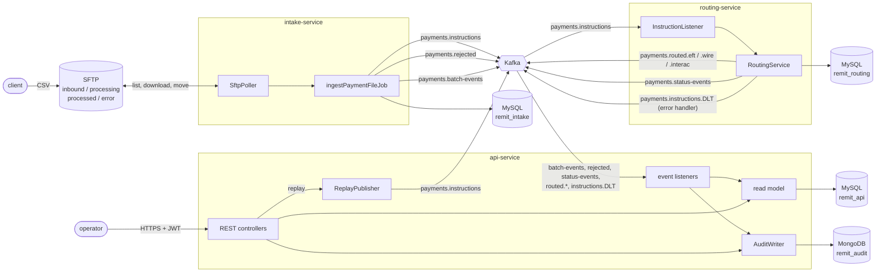
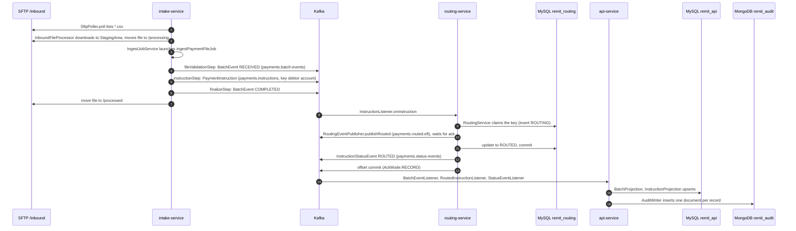
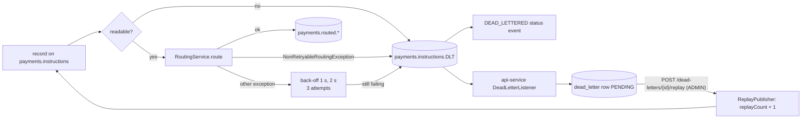
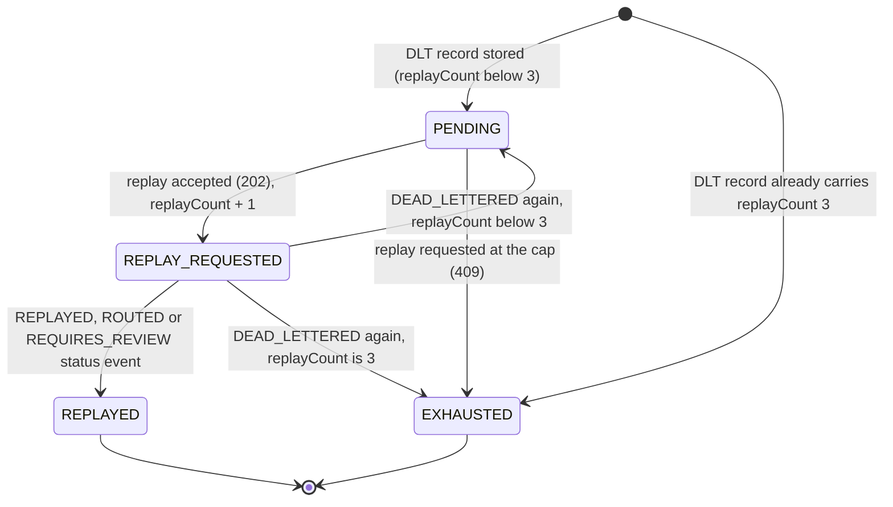
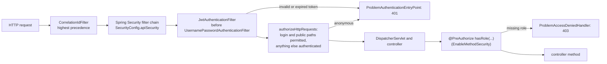

# Remit architecture

This document describes how Remit is built: the services and what they own, the Kafka contract between them, the path one payment instruction takes through the code, and the design of idempotency, dead-lettering, security, data, configuration and observability. The reasons behind individual choices are in the [decision records](decisions/README.md); operating procedures are in the [runbook](runbook.md).

## Contents

- [Overview](#overview)
- [Services](#services)
- [Kafka topics](#kafka-topics)
- [Events and headers](#events-and-headers)
- [The path of one instruction](#the-path-of-one-instruction)
- [Idempotency](#idempotency)
- [Retries, the dead-letter topic and replay](#retries-the-dead-letter-topic-and-replay)
- [Security](#security)
- [Data model](#data-model)
- [Configuration profiles](#configuration-profiles)
- [Observability](#observability)
- [Deployment views](#deployment-views)
- [Extending intake with a new channel (AS2 or Connect:Direct)](#extending-intake-with-a-new-channel-as2-or-connectdirect)

## Overview

```
            +-----------+       SFTP poll        +-------------------+
 client --> | SFTP      | <--------------------- |  intake-service   |
 drops CSV  | /inbound  |  download, move file   |  (Spring Batch)   |
            +-----------+                        +---------+---------+
                                                           |
                       payments.instructions  (valid)      |   payments.rejected (invalid rows)
                       payments.batch-events                v
                                                  +-------------------+
                                                  |      Kafka        |
                                                  +----+---------+----+
                                                       |         ^
                         consume instructions          |         | routed + status events
                                                       v         |
                                                  +-------------------+      +---------+
                                                  |  routing-service  | ---> | MySQL   |
                                                  |  (idempotent)     |      | routing |
                                                  +---------+---------+      +---------+
                                                            | failures after retries
                                                            v
                                                  payments.instructions.DLT
                                                            |
                                                            v
 operator --JWT--> +-------------------+  consumes batch/status/rejected/DLT events
                   |    api-service    | ---> MySQL (api read model)
                   | (Spring Web/Sec)  | ---> MongoDB (audit_events, append-only)
                   +-------------------+  replay: republish DLT payload to payments.instructions
```

The same system as a component graph, with every topic and data store:



The build is a Maven multi-module project: `remit-common` (shared event records, topic names and pure utilities) and the three Spring Boot 3.5 services on Java 17. All Java code lives under `ca.musakaleem.remit`; Kafka payload classes live in `ca.musakaleem.remit.common.event`, the only package consumers trust.

## Services

| Service | Responsibility | Owns | Main classes |
|---|---|---|---|
| `intake-service` | Poll SFTP, stage files, run the Spring Batch job `ingestPaymentFileJob`, validate files and rows, publish instructions, rejections and batch events, move files to `/processed` or `/error` | MySQL schema `remit_intake`: `file_registry` and the Spring Batch 5 metadata tables | `SftpPoller`, `InboundFileProcessor`, `StagingArea`, `IngestJobService`, `IngestJobConfig`, `FileValidationTasklet`, `InstructionItemProcessor`, `InstructionKafkaWriter`, `FinalizeTasklet`, `IntakeEventPublisher`, `IngestJobsEndpoint` |
| `routing-service` | Consume instructions, enforce idempotency, re-check channel rules, publish to the channel topic and a status event, retry and dead-letter failures | MySQL schema `remit_routing`: `processed_instruction` (the idempotency ledger) | `InstructionListener`, `RoutingService`, `RoutingRules`, `ChaosHook`, `RoutingEventPublisher`, `ErrorHandlingConfig`, `DeadLetterStatusRecoverer`, `DeadLetterDestination` |
| `api-service` | JWT login and the operator REST API, the read model built from events, the append-only audit trail, dead-letter replay | MySQL schema `remit_api` (users, batches, instructions, history, rejections, dead letters); MongoDB database `remit_audit` | `SecurityConfig`, `JwtService`, `JwtAuthenticationFilter`, `AuthService`, the `*Controller` classes, the `*Listener` and `*Projection` classes, `ReplayService`, `ReplayPublisher`, `AuditWriter`, `MongoAuditEventStore` |
| `remit-common` | Contract and utilities, no Spring beans | nothing | `Topics`, `EventHeaders`, `EventType`, the event records, `IdempotencyKeys`, `MaskingUtil`, `RemitJson`, `KafkaJson` |

A service never reads another service's schema. Each MySQL user is granted privileges on its own schema only (`docker/mysql/init-users.sh`), so the rule is enforced by the database. Everything crosses a service boundary as a Kafka event ([ADR 0001](decisions/0001-service-boundaries.md)).

## Kafka topics

Every topic has 3 partitions locally (single broker, replication factor 1). The compose `kafka-init` container and the Kubernetes `kafka-init` Job create all eight before the services start (`docker/kafka/create-topics.sh`; broker auto-creation is off), and each producing service also declares its topics as `NewTopic` beans.

| Topic | Key | Producer | Consumers | `NewTopic` bean in |
|---|---|---|---|---|
| `payments.instructions` | debtor account | intake-service (`IntakeEventPublisher`), api-service replay (`ReplayPublisher`) | routing-service (`InstructionListener`, group `routing-service`) | intake, api |
| `payments.rejected` | batch id | intake-service | api-service (`RejectionListener`) | intake |
| `payments.batch-events` | batch id | intake-service | api-service (`BatchEventListener`) | intake |
| `payments.routed.eft` | idempotency key | routing-service (`RoutingEventPublisher`) | api-service (`RoutedInstructionListener`, for payment details; [ADR 0010](decisions/0010-api-read-model.md)) | routing |
| `payments.routed.wire` | idempotency key | routing-service | api-service (`RoutedInstructionListener`) | routing |
| `payments.routed.interac` | idempotency key | routing-service | api-service (`RoutedInstructionListener`) | routing |
| `payments.status-events` | idempotency key | routing-service (`RoutingEventPublisher`, `DeadLetterStatusRecoverer`) | api-service (`StatusEventListener`) | routing |
| `payments.instructions.DLT` | original key | routing-service error handler (`DeadLetterPublishingRecoverer`) | api-service (`DeadLetterListener`, raw bytes) | routing |

Producers use `acks=all` and `enable.idempotence=true` and wait for the acknowledgement of every send they depend on. Consumers run with `enable.auto.commit=false`, `AckMode.RECORD` and concurrency 3 (one thread per partition). api-service uses one consumer group, `api-service`, for all its listeners.

Keys decide ordering. Instructions are keyed by debtor account, so one debtor's instructions stay in order on one partition (FR-INT-05), and repeated deliveries of one instruction normally reach the same routing thread. Status events and routed records are keyed by idempotency key, so `REPLAYED` and the `ROUTED` that follows it arrive in that order. Batch events and rejections are keyed by batch id, so one api-service thread sees every event of a batch.

## Events and headers

Payloads are Java records in `remit-common`, serialized as JSON by Spring Kafka's `JsonSerializer` with a `__TypeId__` header. Consumers wrap `JsonDeserializer` in `ErrorHandlingDeserializer` and trust type headers only from `ca.musakaleem.remit.common.event` (`KafkaJson.TRUSTED_PACKAGES`).

| Record | Topic(s) | Content |
|---|---|---|
| `PaymentInstruction` | `payments.instructions`, `payments.routed.*`, DLT | `idempotencyKey`, `batchId`, `clientId`, `instructionRef`, `debtor` and `creditor` (`Party`: name, institution, transit, account), `amount` (`BigDecimal`), `currency`, `channel`, `valueDate`, `remittanceInfo`, `replayCount` |
| `InstructionRejected` | `payments.rejected` | `batchId`, `clientId`, `lineNumber`, `instructionRef`, `reasonCodes`, `rawLine` with account digits masked |
| `BatchEvent` | `payments.batch-events` | `batchId`, `clientId`, `fileName`, `fileHash`, `status` (`BatchStatus`: RECEIVED, COMPLETED, COMPLETED_WITH_ERRORS, FAILED), row counts, `controlTotal`, `occurredAt` |
| `InstructionStatusEvent` | `payments.status-events` | `idempotencyKey`, `batchId`, `status` (`InstructionStatus`: ROUTED, REQUIRES_REVIEW, DUPLICATE, DEAD_LETTERED, REPLAYED), `channel`, `detail`, `occurredAt` |

`EventHeaders.record(...)` adds the five standard headers to every record:

| Header | Value |
|---|---|
| `eventId` | random UUID per published event; api-service uses it as the audit document id and to deduplicate status history |
| `eventType` | an `EventType` name: `PAYMENT_INSTRUCTION`, `INSTRUCTION_REJECTED`, `BATCH_RECEIVED`, `BATCH_COMPLETED`, `INSTRUCTION_STATUS`, `INSTRUCTION_ROUTED` |
| `occurredAt` | ISO-8601 UTC instant |
| `correlationId` | the batch id (a fresh id for a duplicate file attempt) |
| `schemaVersion` | `1` |

Extra headers: `reasonCode` on a FAILED batch event (`DUPLICATE_FILE`, `CONTROL_TOTAL_MISMATCH`, ...), `routingStatus` (`ROUTED` or `REQUIRES_REVIEW`) on routed records, and Spring's `kafka_dlt-*` exception and origin headers on DLT records ([ADR 0003](decisions/0003-dlt-and-replay.md)).

## The path of one instruction

This follows the first row of `samples/PAY_ACME01_20261015093000.csv` (`ACME-0001`, an EFT of 1,250.00 CAD) from the SFTP drop to the operator's screen. Every name is a class in the repository.



### 1. intake-service: from the drop to a published instruction

1. **`SftpPoller.poll()`** runs every `remit.sftp.poll-interval` (`@Scheduled`, default 30 s, 10 s in compose). It calls **`SftpFileGateway.listCsvFiles("/inbound")`**, implemented by **`SpringIntegrationSftpFileGateway`** on an `SftpRemoteFileTemplate` over Spring Integration's caching `DefaultSftpSessionFactory` (`SftpConfig`, credentials from `SftpProperties`). Files come back sorted by name, so the five samples are processed in time stamp order.
2. **`InboundFileProcessor.process(fileName)`** puts `fileName` in the MDC and parses the name with **`BatchFileName.parse`** (`PAY_<CLIENTID>_<yyyyMMddHHmmss>.csv`). A bad name is moved to `/error` with an `INVALID_FILENAME` note and never reaches the job.
3. **`StagingArea.stage`** downloads the file through `SftpFileGateway.download` into `<staging>/<name>.part`, hashes it with **`FileHashing.sha256`**, and moves it to `<staging>/<sha256>/<name>`, returning a **`StagedFile`** (name, hash, path). The processor then moves the remote file to `/processing`.
4. **`IngestJobService.launch`** builds the job parameters `fileName`, `clientId`, `fileHash`, `stagedPath` (names in **`IngestJob`**) and runs **`ingestPaymentFileJob`** (wired in **`IngestJobConfig`**) synchronously with Spring Batch's `JobLauncher`. The job's **`JobMdcListener`** keeps the MDC keys set on the batch threads.
5. **`fileValidationStep`** runs **`FileValidationTasklet`**:
   - re-checks the name (`BatchFileName`) and verifies that the staged bytes still hash to `fileHash`;
   - asks **`FileRegistryRepository.existsByFileHash`** whether the content was seen before (`DUPLICATE_FILE`);
   - reads the file with **`ScannedFile.scan`** (header, records, trailer, using the same record separator policy as the reader) and checks it with **`PaymentFileValidator.check`**: header equals `PaymentFileFormat.HEADER`, **`Trailer.parse`**, zero rows, record count, control total (`BigDecimal`, compared with `compareTo`). The result is a **`FileCheck`**, which also lists lines whose `instruction_ref` repeats an earlier row;
   - assigns a batch id, saves a **`FileRegistryEntry`** (`file_registry`, unique `file_hash`), stores record count, control total and duplicate lines in the job execution context, and publishes `BatchEvent(RECEIVED)` with **`IntakeEventPublisher.publishBatchEvent`** (waits for the acknowledgement).
6. **`instructionStep`** is a fault-tolerant chunk step (chunk size 100, `remit.intake.chunk-size`):
   - reader: a step-scoped `FlatFileItemReader` that skips the header and reads exactly `recordCount` rows (never the trailer), mapping each line with **`InstructionLineMapper`** (tokenized by **`PaymentFileFormat.tokenize`**) to a **`RawInstruction`**;
   - processor: **`InstructionItemProcessor`** calls **`InstructionValidator.validate`** (every field rule of spec 3.3 plus the channel rules from **`RoutingRulesProperties`**, against the business date from **`BusinessCalendar.today(clock)`** in America/Toronto) and adds `DUPLICATE_INSTRUCTION_REF_IN_FILE` for repeated references. `ACME-0001` is valid, so **`InstructionValidator.toInstruction`** builds the `PaymentInstruction` with `IdempotencyKeys.forInstruction("ACME01", "ACME-0001")` (SHA-256 of `ACME01|ACME-0001`) and `replayCount` 0. An invalid row throws **`InstructionValidationException`**, which **`InstructionSkipPolicy`** skips (up to `remit.intake.skip-limit`) and **`RejectedInstructionListener.onSkipInProcess`** publishes as `InstructionRejected` with `MaskingUtil.maskAccountNumbers` applied to the raw line;
   - writer: **`InstructionKafkaWriter.write`** sends every instruction of the chunk with **`IntakeEventPublisher.publishInstruction`** (topic `payments.instructions`, key = debtor account, headers from **`EventHeaders.record`**) and calls `awaitAll`, so the chunk commits only after Kafka acknowledged all its records. **`InstructionStepListener`** records whether the skip limit stopped the step.
7. **`finalizeStep`** runs **`FinalizeTasklet`**: it totals the instruction step over every execution of the job instance (a restarted job has several), lets **`BatchOutcome.decide`** pick COMPLETED, COMPLETED_WITH_ERRORS or FAILED (more than 50% rejected, or the skip limit hit), updates the `FileRegistryEntry`, and publishes the final `BatchEvent`.
8. Back in **`InboundFileProcessor.complete`**, the **`JobOutcome`** decides the remote move: `PROCESSED` to `/processed`, `REJECTED` to `/error` plus `<file>.error.txt` (`SftpFileGateway.writeText`), `INCOMPLETE` (a technical failure) leaves it in `/processing` for a restart. **`StagingArea.discard`** deletes the staged copy unless a restart needs it.

### 2. routing-service: from `payments.instructions` to `payments.routed.eft`

9. The listener container (group `routing-service`) polls the record. `ErrorHandlingDeserializer` around `JsonDeserializer<PaymentInstruction>` (`KafkaConfig.remitInstructionDeserializer`) turns the JSON back into a `PaymentInstruction`; a record it cannot read goes straight to the error handler.
10. **`InstructionListener.onInstruction`** puts `correlationId` and `idempotencyKey` in the MDC and calls **`RoutingService.route`**.
11. **`RoutingRules.requireRoutable`** checks that the fields needed to claim the key are present (else **`NonRetryableRoutingException`**).
12. **Claim, transaction 1.** `RoutingService` saves a new **`ProcessedInstruction`** (status **`ProcessingStatus.ROUTING`**, `attempts` 1) with **`ProcessedInstructionRepository.saveAndFlush`** inside a `TransactionTemplate`. A `DataIntegrityViolationException` means the key exists: in a fresh transaction it loads the row, and a final status (`ROUTED`, `REQUIRES_REVIEW`) makes this delivery a duplicate (publish `DUPLICATE`, return), while `ROUTING` means an earlier attempt did not finish (`ProcessedInstruction.recordAttempt`, carry on).
13. **Route, no transaction.** **`ChaosHook.apply`** throws a retryable **`RoutingException`** for `remittanceInfo = FORCE_FAIL` when `remit.routing.chaos-enabled` is on. **`RoutingRules.decide`** re-checks the channel rules (bound by **`RoutingProperties`**) and returns a **`RoutingDecision`**: channel `EFT`, topic `payments.routed.eft`, outcome `ROUTED` (`REQUIRES_REVIEW` for a WIRE of 1,000,000.00 or more). **`RoutingEventPublisher.publishRouted`** sends the instruction to that topic keyed by idempotency key, with the `routingStatus` header, and blocks on `send(...).get(timeout)`.
14. **Record, transaction 2.** `ProcessedInstruction.finish(ROUTED)` updates the row; `@Version` turns a concurrent update into an optimistic locking failure instead of a lost update.
15. **Announce.** **`RoutingEventPublisher.publishStatus`** sends `InstructionStatusEvent(ROUTED)` to `payments.status-events` (preceded by `REPLAYED` when `replayCount > 0`).
16. The listener returns and the container commits the offset.

### 3. api-service: from the topics to the operator

17. **`BatchEventListener`** applies the RECEIVED and COMPLETED batch events through **`BatchProjection.apply`** to **`PaymentBatch`** (`PaymentBatchRepository`), ignoring events older than the stored `updated_at`.
18. **`RoutedInstructionListener.onRouted`** reads the routed record (header data through **`EventMetadata`**) and calls **`InstructionProjection.applyRouted`**, which creates or locks the **`InstructionRecord`** row with **`InstructionRecordRepository.claim`** (`INSERT ... ON DUPLICATE KEY UPDATE`, then `SELECT ... FOR UPDATE`) and fills in the parties, amount and value date.
19. **`StatusEventListener.onStatusEvent`** calls **`InstructionProjection.applyStatus`**: one **`InstructionStatusHistory`** row per `eventId`, the current status on `InstructionRecord` unless the event is older or a `DUPLICATE`, and **`DeadLetterProjection.onInstructionStatus`** for a pending replay.
20. Each listener then calls **`AuditWriter.recordEvent`**, which sanitizes the details with **`AuditDetails`** and inserts an **`AuditEvent`** through **`MongoAuditEventStore.insert`** (`MongoTemplate.insert`; a duplicate `eventId` is a no-op). The routed record writes `INSTRUCTION_ROUTED`, the status event `INSTRUCTION_STATUS_CHANGED` ([ADR 0009](decisions/0009-audit-event-types.md)).
21. An operator calls `GET /api/v1/instructions/{key}`: **`CorrelationIdFilter`** sets `X-Correlation-Id`, **`JwtAuthenticationFilter`** authenticates the bearer token, **`InstructionController`** (`@PreAuthorize("hasRole('OPERATOR')")`) returns an **`InstructionDetailView`** with accounts masked unless the caller is ADMIN (**`Callers`**).

A rejected row takes the short path `RejectedInstructionListener` (intake) to `payments.rejected` to **`RejectionListener`**, **`RejectionProjection`**, **`InstructionRejection`** and an `INSTRUCTION_REJECTED` audit document.

## Idempotency

There are two keys (spec 3.6), both SHA-256 in hex and both derived in `remit-common`'s `IdempotencyKeys`:

| Key | Derivation | Enforced by |
|---|---|---|
| File hash | SHA-256 of the file bytes | unique `file_registry.file_hash` in `remit_intake`; also part of the Spring Batch job instance key, so a byte-identical file under the same name cannot start a second instance |
| Instruction key | SHA-256 of `clientId + "|" + instruction_ref` | primary key of `processed_instruction` in `remit_routing` |

Every other consumer is idempotent by natural key: api-service upserts batches by batch id, instructions by idempotency key, status history by `eventId`, rejections by batch id and line number, dead letters by original topic, partition and offset, and audit documents by `eventId` (unique index). Redelivery and reordering therefore change nothing ([ADR 0010](decisions/0010-api-read-model.md)).

The routing ledger is the core of the design. Kafka delivers at least once, so routing-service must tolerate the same instruction arriving again after a crash, a rebalance, a retry, a restarted intake chunk, a client resending a reference, or a replay. The ledger turns all of these into one of two cases: the key is new or unfinished (route it) or the key is final (report `DUPLICATE`). [ADR 0002](decisions/0002-idempotency.md) walks through every crash point. In short:

- The ledger never says `ROUTED` for an instruction that was not acknowledged on its channel topic, because the update runs after the broker acknowledged.
- A crash between the routed publish and the ledger update republishes the routed record on the next delivery (same key, same partition). The routed topics are therefore at-least-once and a downstream consumer must deduplicate by key. A transactional outbox (stretch item S4) would close that gap.
- Kafka's producer idempotence and transactions do not replace the ledger: they deduplicate retries of one send and make consume-produce-commit atomic inside Kafka, but they cannot see a MySQL write or recognize two different records carrying the same instruction.

## Retries, the dead-letter topic and replay



routing-service (FR-RTE-03, `ErrorHandlingConfig`):

- `DefaultErrorHandler` with `ExponentialBackOffWithMaxRetries(2)`, 1 s initial, multiplier 2: three attempts in total. The partition waits at most about 3 s; other partitions keep flowing.
- `NonRetryableRoutingException` (channel rule violation, missing key fields) and Spring's non-retryable defaults (including `DeserializationException`) go to the DLT on the first attempt. A poison pill never blocks the records behind it.
- `DeadLetterPublishingRecoverer` with `DeadLetterDestination` writes to `payments.instructions.DLT`, same partition, original key, value and headers plus the `kafka_dlt-*` headers. `DeadLetterStatusRecoverer` then publishes `InstructionStatusEvent(DEAD_LETTERED)` (not for a poison pill, which has no readable key).
- The ledger row of a dead-lettered instruction stays `ROUTING`, which is what lets a replay through.

api-service:

- `DeadLetterListener` reads the DLT as raw bytes, `DeadLetterRecordParser` turns a record into a `DeadLetterRecord`, and `DeadLetterProjection.record` stores one `DeadLetter` row per dead-lettered instruction, keeping that row across its replays.
- `POST /api/v1/dead-letters/{id}/replay` (`DeadLetterController`, ADMIN only) runs `ReplayService.replay`: lock the row (`findByIdForUpdate`), check the rules in `DeadLetter.requestReplay`, republish the stored payload with `replayCount + 1` through `ReplayPublisher` (key debtor account, the five headers), audit `DLT_REPLAY_REQUESTED` with the administrator's name, and commit only after Kafka acknowledged (else 503 and nothing changes).
- The cap is enforced by api-service only: `remit.replay.max-replays`, 3 by default (`ReplayProperties`). routing-service processes a replay like any instruction.

The dead letter state machine (`DeadLetterStatus`, transitions in `DeadLetter`):



A replay is refused with 409 while one is `REPLAY_REQUESTED`, once the dead letter is `REPLAYED`, when it is `EXHAUSTED` or reaches the cap, and for an unreadable record (no idempotency key). Status events that happened before the replay was requested are ignored for the state machine. Details: [ADR 0003](decisions/0003-dlt-and-replay.md) and [ADR 0010](decisions/0010-api-read-model.md#dead-letters).

## Security



- `SecurityConfig` builds a stateless chain: no session (`SessionCreationPolicy.STATELESS`), no CSRF (bearer tokens only, no cookies), no form, basic or logout. Public: `POST /api/v1/auth/login`, `/actuator/health/**`, `/actuator/info`, Swagger UI and `/v3/api-docs`.
- **Where the JWT is validated:** `JwtAuthenticationFilter` (a `OncePerRequestFilter` added before `UsernamePasswordAuthenticationFilter`) reads `Authorization: Bearer <token>` and calls `JwtService.parse`, which verifies the HS256 signature with the key from `REMIT_JWT_SECRET` (`JwtProperties`), pins the algorithm, rejects unsigned tokens and checks `exp`, `iat`, `sub` and `roles`. A bad token is answered with 401 at once by `ProblemAuthenticationEntryPoint`; a missing token continues anonymously and is refused by the authorization rules.
- **How `@PreAuthorize` gets roles:** the filter maps each entry of the `roles` claim to a `SimpleGrantedAuthority("ROLE_<role>")` and stores an authenticated `UsernamePasswordAuthenticationToken` (principal = username, details = `TokenClaims`) in the `SecurityContextHolder`. `@EnableMethodSecurity` makes `@PreAuthorize("hasRole('OPERATOR')")` and `hasRole('ADMIN')` on the controller methods check those authorities. Roles are not hierarchical; `admin` holds both.
- **Login:** `AuthController` calls `AuthService.login`, which checks `LoginAttemptService` (5 failures in 10 minutes lock a username for 10 minutes, in memory, 429 with `Retry-After`), authenticates with the `AuthenticationManager` (`AppUserDetailsService` over `AppUserRepository`, BCrypt via `SecurityConfig.passwordEncoder`), issues the token with `JwtService.issue` (claims `sub`, `roles`, `iat`, `exp` = 15 minutes, `jti`) and audits `LOGIN_SUCCESS` or `LOGIN_FAILURE`.
- Errors are RFC 7807 `ProblemDetail` documents written by `ProblemResponseWriter` (security) and `ApiExceptionHandler` (MVC), never with stack traces.
- `UserSeeder` creates `operator` and `admin` from `REMIT_OPERATOR_PASSWORD` and `REMIT_ADMIN_PASSWORD` when `remit.security.seed-users.enabled` is true (`local`, `docker`, and the kind overlay).

The reasoning (jjwt rather than `oauth2-resource-server`, seeding in Java rather than Flyway, the lockout trade-offs) is in [ADR 0004](decisions/0004-jwt-approach.md).

## Data model

All MySQL schemas are created by Flyway migrations in each service (`src/main/resources/db/migration`) and validated by Hibernate (`ddl-auto=validate`). Times are `TIMESTAMP(3)` in UTC; money is `DECIMAL(15,2)` mapped to `BigDecimal`.

### `remit_intake` (intake-service)

| Table | Entity | Key and indexes | Purpose |
|---|---|---|---|
| `file_registry` | `FileRegistryEntry` | PK `id`; unique `batch_id`; unique `file_hash`; index `(client_id, received_at)` | One row per accepted or file-level-failed file; the unique hash is the duplicate file guard |
| `BATCH_JOB_INSTANCE`, `BATCH_JOB_EXECUTION`, `BATCH_JOB_EXECUTION_PARAMS`, `BATCH_JOB_EXECUTION_CONTEXT`, `BATCH_STEP_EXECUTION`, `BATCH_STEP_EXECUTION_CONTEXT` and their sequences | Spring Batch | official Spring Batch 5 MySQL schema (`V1__spring_batch_metadata.sql`) | Job repository, used for restarts |

### `remit_routing` (routing-service)

| Table | Entity | Key and indexes | Purpose |
|---|---|---|---|
| `processed_instruction` | `ProcessedInstruction` | PK `idempotency_key`; index `batch_id`; `version` for `@Version` | Idempotency ledger: status `ROUTING`, `ROUTED` or `REQUIRES_REVIEW`, `attempts`, channel, amount |

### `remit_api` (api-service)

| Table | Entity | Key and indexes | Purpose |
|---|---|---|---|
| `app_user`, `app_user_role` | `AppUser` (roles as `Role` values) | PK `id`, unique `username`; PK `(user_id, role)` | Operators with BCrypt hashes |
| `payment_batch` | `PaymentBatch` | PK `batch_id`; indexes `received_at`, `(status, received_at)`, `(client_id, received_at)` | Batch read model |
| `payment_instruction` | `InstructionRecord` | PK `idempotency_key`; indexes `(batch_id, status)`, `(batch_id, channel)`, `(status, updated_at)` | Current status and payment details |
| `instruction_status_history` | `InstructionStatusHistory` | PK `id`; unique `event_id`; indexes `(idempotency_key, occurred_at)`, `(status, occurred_at)` | Every status event received |
| `instruction_rejection` | `InstructionRejection` | PK `id`; unique `(batch_id, line_number)`; index `occurred_at` | Rejected rows with reason codes and the masked line |
| `dead_letter` | `DeadLetter` | PK `id`; unique `(original_topic, original_partition, original_offset)`; indexes `first_seen_at`, `(status, first_seen_at)`, `idempotency_key` | Dead letters, JSON `payload`, replay count and status |

### MongoDB `remit_audit.audit_events` (api-service)

One `AuditEvent` document per consumed record and per operator action: `eventId`, `eventType`, `entityType` (`BATCH`, `INSTRUCTION`, `USER`, `DEAD_LETTER`), `entityId`, `actor` (`system:api-service` or `user:<username>`), `occurredAt`, `correlationId`, `details` (accounts masked by `AuditDetails`).

| Index | Fields | Purpose |
|---|---|---|
| `ux_audit_event_id` | `{eventId: 1}`, unique | makes audit writes idempotent |
| `ix_audit_entity_occurred` | `{entityId: 1, occurredAt: -1}` | history of one batch, instruction or user |
| `ix_audit_type_occurred` | `{eventType: 1, occurredAt: -1}` | filter by event type |

The indexes and an `auditAppendOnly` role (`find`, `insert`, `listIndexes` only) are created by `docker/mongo/init.js`, which compose and the Kubernetes overlay both run; api-service has `auto-index-creation: false`. The `AuditEventStore` interface has `insert` and `find` only, so the trail is append-only in code and in the database.

## Configuration profiles

Each service has one `application.yml` with a default section and four profile sections. Every secret comes from an environment variable ([.env.example](../.env.example)); nothing secret has a default.

| Profile | Used by | Differences from the defaults |
|---|---|---|
| (default) | the base for all | hosts `localhost` with the compose host ports (MySQL 3307, MongoDB 27018, Kafka 29092, SFTP 2222), production-like values (30 s poll, real business date, chaos hook off, no seeded users) |
| `local` | a jar or IDE run against the compose infrastructure | health details shown, unknown SFTP host keys accepted, chaos hook on (routing), user seeding on (api) |
| `docker` | the compose stack | hosts are compose service names on their internal ports, staging in the `intake-staging` volume, chaos hook on, user seeding on |
| `k8s` | the Kubernetes Deployments (`remit-config` ConfigMap sets `SPRING_PROFILES_ACTIVE=k8s`) | hosts are Kubernetes Service names, staging in an `emptyDir` at `/staging`, chaos hook and seeding off unless the overlay's ConfigMap turns them on |
| `test` | integration tests (`@ActiveProfiles("test")`) | plain text logs, poller off, business date pinned to 2026-10-15; container addresses come from Testcontainers |

Demo switches that matter when reading the code: `remit.clock.fixed-date` / `REMIT_CLOCK_FIXED_DATE` pins the business date ([ADR 0005](decisions/0005-demo-clock.md)), `remit.routing.chaos-enabled` turns on the `FORCE_FAIL` hook, `remit.security.seed-users.enabled` / `REMIT_SEED_USERS_ENABLED` seeds the two users. Channel limits live under `remit.routing.rules` in both intake and routing ([ADR 0008](decisions/0008-channel-rules-per-service.md)).

## Observability

- **JSON logs.** Every service logs to stdout with `logstash-logback-encoder`'s `LogstashEncoder` (`logback-spring.xml`), except under the `test` profile. `scripts/logs.sh <service>` follows them pretty-printed with jq.
- **Fields.** `service` is a logback context property from `spring.application.name`. MDC keys (constants in each service's `MdcKeys`):

  | Key | Set by | Meaning |
  |---|---|---|
  | `correlationId` | `FileValidationTasklet` and `JobMdcListener` (intake), `InstructionListener` (routing), every listener and `CorrelationIdFilter` (api) | batch id, or the HTTP request's `X-Correlation-Id` |
  | `idempotencyKey` | `InstructionKafkaWriter` (intake), `InstructionListener` (routing), status, routed and dead-letter listeners (api) | instruction key |
  | `fileName` | `InboundFileProcessor`, `JobMdcListener` (intake) | file being ingested |

- **Masking.** `MaskingUtil.maskAccount` and `maskAccountNumbers` keep the last four digits; no log line, API response (except the ADMIN instruction detail) or audit document holds a full account number. Tokens and passwords are never logged.
- **Actuator.** `health` (with `liveness` and `readiness` probe groups), `info` and `metrics` on every service; intake adds `ingestjobs` (`IngestJobsEndpoint`, list and restart job executions). Health includes the database and Kafka (`KafkaHealthIndicator` in routing and api) and MongoDB in api. In api-service `/actuator/metrics` needs a token.
- **Ports.** api 8080, intake 8081, routing 8082 (actuator on the same port).

## Deployment views

| Environment | How | Notes |
|---|---|---|
| Docker Compose | `docker-compose.yml`: MySQL 8.4, MongoDB 7, Kafka 3.9 (KRaft), `kafka-init`, atmoz/sftp, the three services, optional Kafka UI | Health-gated start order; local-only MySQL durability and poll settings ([ADR 0011](decisions/0011-local-stack-settings.md)) |
| Kubernetes (kind) | `k8s/base` (three Deployments, Services, ConfigMap, PodDisruptionBudget) plus `k8s/overlays/local` (infrastructure StatefulSets, NodePort 30080) | routing-service runs 2 replicas, intake 1 with `Recreate` so there is never a second poller ([ADR 0013](decisions/0013-kubernetes-local-overlay.md)) |
| CI | Jenkins with a Docker-in-Docker sidecar and SonarQube (`ci/`) | [ADR 0012](decisions/0012-ci-docker-strategy.md) |

Images are two-stage builds (`maven:3-eclipse-temurin-17`, then `eclipse-temurin:17-jre` with the Spring Boot layers, uid 10001, `HEALTHCHECK` on actuator health).

## Extending intake with a new channel (AS2 or Connect:Direct)

AS2 and Connect:Direct are out of scope (spec 1.2), but the code keeps the transport behind one interface so another one can be added without touching the batch job.

What is transport-specific today:

- `SftpFileGateway` (`intake/sftp`): `listCsvFiles(directory)`, `download(directory, fileName, target)`, `move(fromDirectory, toDirectory, fileName)` and `writeText(directory, fileName, content)`. The only implementation is `SpringIntegrationSftpFileGateway`, created in `SftpConfig` from `SftpProperties`.
- `SftpPoller`, which decides *when* to look for files (a fixed delay).

What is transport-neutral and stays as it is: `InboundFileProcessor` (works only with the gateway and directory names), `StagingArea`, `IngestJobService`, the whole `ingestPaymentFileJob`, the validators, the publishers, and everything downstream. The job reads the staged local copy, never the remote server.

### Pull-style transports (Connect:Direct)

Connect:Direct (IBM Sterling) usually delivers into a directory on a node that the receiving side can read, either a local or mounted file system or a staging server reached over SFTP.

1. Add `ConnectDirectFileGateway implements SftpFileGateway` (better: first rename the interface to `InboundFileGateway`, a mechanical refactor, since nothing in it is SFTP-specific). Map the four operations onto the landing directories: list completed files only (Connect:Direct writes to a temporary name and renames on completion, or signals completion with a process step, which is the equivalent of the `.part` convention `scripts/seed-sftp.sh` uses), `download` copies into the staging path, `move` renames between `inbound`, `processing`, `processed` and `error`, `writeText` writes the `.error.txt` note.
2. Add `ConnectDirectProperties` and a `@Configuration` that creates the gateway bean under `@ConditionalOnProperty(prefix = "remit.intake", name = "transport", havingValue = "connect-direct")`, and put `@ConditionalOnProperty(... havingValue = "sftp", matchIfMissing = true)` on the SFTP beans in `SftpConfig`, so exactly one gateway exists.
3. Keep `SftpPoller` (rename to `InboundPoller`) as the scheduler; it already handles a failed poll and a failed file without stopping.
4. Tests: a unit test of the gateway against a temporary directory, and an `InboundPollerIT` variant with the new transport. `SampleFilesJobIT` and the rest stay unchanged because they start from staged files.

### Push-style transports (AS2)

AS2 is HTTP-based: the trading partner pushes a signed and usually encrypted message, and the receiver must return a signed MDN (receipt), synchronously or asynchronously. There is nothing to poll, so the gateway interface is used the other way round:

1. Terminate AS2 in a dedicated component: an AS2 server (for example an OpenAS2 instance or a commercial gateway) that verifies the signature, decrypts, checks the partner certificate, sends the MDN, and writes the payload into a landing directory or object store. Running that inside intake-service would mix certificate management and a public HTTP endpoint into the batch service, so a separate deployable is the better boundary.
2. intake-service then reads that landing area through an `InboundFileGateway` implementation (local directory, or SFTP if the AS2 server exposes one), exactly as for Connect:Direct. The client id still comes from the file name; if partners cannot follow the naming convention, the AS2 component renames files from the AS2 `AS2-From` identifier to `PAY_<CLIENTID>_<timestamp>.csv`.
3. If an event-driven hand-off is preferred to polling, the AS2 component can publish a `FileArrived` event, and a small listener in intake-service calls `InboundFileProcessor.process(fileName)` for it. The processor already takes one file name and does the rest.

Both routes keep the guarantees intact: the file hash and `file_registry` still stop duplicate files whatever the transport, and the job still publishes only validated instructions. Choosing between them, and the certificate and partner management that AS2 needs, would deserve its own ADR.
