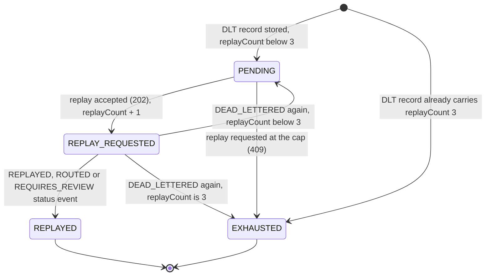

# ADR 0003: Retries, the dead-letter topic and replay

- Status: accepted
- Date: 2026-09-30

## Context

Some instructions cannot be routed. The reason may be temporary (MySQL or Kafka briefly unavailable, the FR-RTE-04 chaos hook), permanent (an INTERAC payment in USD, which intake should have rejected but a replay could still carry), or the record may not even be readable (malformed JSON, an untrusted type header). A failing record must not block the rest of its partition, must not be lost, and an operator must be able to see it and send it again.

## Decision

### Retries

The listener container uses Spring Kafka's `DefaultErrorHandler` (`ErrorHandlingConfig`):

- `ExponentialBackOffWithMaxRetries(2)`, initial interval 1 s, multiplier 2: attempt 1, wait 1 s, attempt 2, wait 2 s, attempt 3. Three attempts in total, then the record is recovered (dead-lettered).
- The error handler seeks the partition back to the failed record between attempts, so later records on the same partition wait for at most about 3 seconds. Other partitions keep flowing.
- Retryable: `RoutingException` (failed publish, chaos hook) and anything not listed below.
- Not retryable, dead-lettered on the first attempt:
  - `NonRetryableRoutingException`: a channel rule violation or a record without the fields needed to claim its key. Added with `addNotRetryableExceptions`.
  - Spring's defaults, which include `DeserializationException`, `MessageConversionException`, `ClassCastException` and `MethodArgumentResolutionException`.

The FR-RTE-02 ledger counts each attempt, so a record dead-lettered after its retries has `attempts = 3` and a rule violation has `attempts = 1`. Its row stays `ROUTING`, which is what lets a replay be processed.

### Poison pills

The value deserializer is `ErrorHandlingDeserializer` wrapping a `JsonDeserializer<PaymentInstruction>` that trusts type headers only from `ca.musakaleem.remit.common.event`. A record that cannot be read does not throw inside `poll()` (which would stop the consumer on that offset forever). The error handling deserializer returns `null` and stores the exception in a header; the container hands the record straight to the error handler, which dead-letters it without retries, and the next record on the partition is processed.

### The dead-letter topic

`DeadLetterPublishingRecoverer` publishes to `payments.instructions.DLT`. Spring Kafka 3.3 would name it `payments.instructions-dlt` by default, so `DeadLetterDestination` names it explicitly: same partition number as the source record, or partition 0 if the DLT has fewer partitions. The DLT record keeps:

- the original key (debtor account) and value. A readable instruction is written back as JSON with a `__TypeId__` header; a poison pill is written as its original bytes.
- all original headers (`eventId`, `eventType`, `occurredAt`, `correlationId`, `schemaVersion`).
- Spring's default exception and origin headers:

| Header | Value |
|---|---|
| `kafka_dlt-exception-fqcn` | Exception class. For a routing failure this is `ListenerExecutionFailedException`; for a poison pill `DeserializationException` |
| `kafka_dlt-exception-cause-fqcn` | Root cause class, for example `ca.musakaleem.remit.routing.error.RoutingException` or `NonRetryableRoutingException` |
| `kafka_dlt-exception-message` | Exception message; for listener failures `Listener method ... threw exception; <root cause message>` |
| `kafka_dlt-exception-stacktrace` | Full stack trace |
| `kafka_dlt-original-topic` | `payments.instructions` |
| `kafka_dlt-original-partition` | 4-byte big-endian int |
| `kafka_dlt-original-offset` | 8-byte big-endian long |
| `kafka_dlt-original-timestamp` | 8-byte big-endian long (epoch ms) |
| `kafka_dlt-original-timestamp-type` | `CreateTime` |
| `kafka_dlt-original-consumer-group` | `routing-service` |

After the DLT write succeeds, `DeadLetterStatusRecoverer` publishes `InstructionStatusEvent(DEAD_LETTERED)` with the root cause message (at most 500 characters) as `detail`. A poison pill has no readable idempotency key, so it gets only its DLT record; api-service must build its dead-letter entry from the DLT record alone.

### Replay

routing-service defines the contract, api-service enforces the cap:

- api-service consumes `payments.instructions.DLT` as raw bytes (`DeadLetterListener`, `DeadLetterRecordParser`) and stores each dead-lettered instruction as one `dead_letter` row (payload, exception, original topic, partition and offset, first seen, replay count, status). The same row follows the instruction through its replays ([ADR 0010](0010-api-read-model.md#dead-letters)).
- To replay (`POST /api/v1/dead-letters/{id}/replay`, ADMIN only), `ReplayService` locks the row, reads the stored payload, sets `replayCount` to the stored value plus 1, and `ReplayPublisher` publishes it to `payments.instructions` like intake does: key = debtor account, JSON with `__TypeId__ = ca.musakaleem.remit.common.event.PaymentInstruction`, and the five standard headers with `eventType = PAYMENT_INSTRUCTION` and `correlationId = batchId`. The transaction commits only after Kafka acknowledged; otherwise the caller gets 503 and nothing changes. The replay is audited as `DLT_REPLAY_REQUESTED` with actor `user:<admin>`.
- **The cap lives in api-service only.** `remit.replay.max-replays` (`ReplayProperties`, default 3) is checked in `DeadLetter.requestReplay`: a replay is refused with 409 when `replayCount >= 3`, while a replay is pending, after a successful replay, and for an unreadable record. routing-service does not check the cap and processes a replay like any other instruction; a client that bypassed api-service and republished directly would not be limited, which is acceptable because only api-service and intake-service write to `payments.instructions`.
- routing-service processes the replay normally. The ledger row is still `ROUTING` (or absent), so the replay is not a duplicate. On success it publishes `REPLAYED` (detail `replay <n>`) and then `ROUTED` or `REQUIRES_REVIEW`, both keyed by idempotency key and therefore in that order on one partition. If the replay fails again, it goes back to the DLT with the incremented `replayCount` in its payload and another `DEAD_LETTERED` status event.
- Poison pills cannot be replayed: their payload is not an instruction (409, `replayable: false`).

### Dead letter state machine

`DeadLetterStatus` in api-service; the transitions are methods of the `DeadLetter` entity:

| State | Meaning | Replay request |
|---|---|---|
| `PENDING` | On the DLT and not replayed, or its last replay failed again | 202, unless `replayCount` is already 3 (then 409 and `EXHAUSTED`) |
| `REPLAY_REQUESTED` | Republished, routing-service has not reported the outcome | 409 (pending) |
| `REPLAYED` | The replay was routed | 409 (already replayed) |
| `EXHAUSTED` | Replayed 3 times without success | 409 (limit reached) |

Only status events that happened at or after the replay request move a `REPLAY_REQUESTED` row (`DeadLetter.onInstructionStatus`), so a late event of an earlier attempt cannot settle the current replay. The DLT record of a failed replay can arrive before or after its `DEAD_LETTERED` status event; whichever comes first moves the row back to `PENDING` or on to `EXHAUSTED`, and the second does not change the status again.

## Consequences

- One bad record costs its partition about 3 seconds, not an outage.
- Everything that leaves routing-service without being routed is on the DLT with enough headers to explain why, and (unless unreadable) a `DEAD_LETTERED` status event.
- If publishing `DEAD_LETTERED` fails after the DLT write, the error handler treats recovery as failed and the record is delivered again, which can produce a second DLT record for it. api-service therefore keys dead letters by original topic, partition and offset (unique index on `dead_letter`), so the second record changes nothing.
- The back-off blocks the consumer thread. Non-blocking retry topics (`@RetryableTopic`) would avoid that at the cost of more topics and weaker ordering; the spec asks for a blocking `DefaultErrorHandler`.
